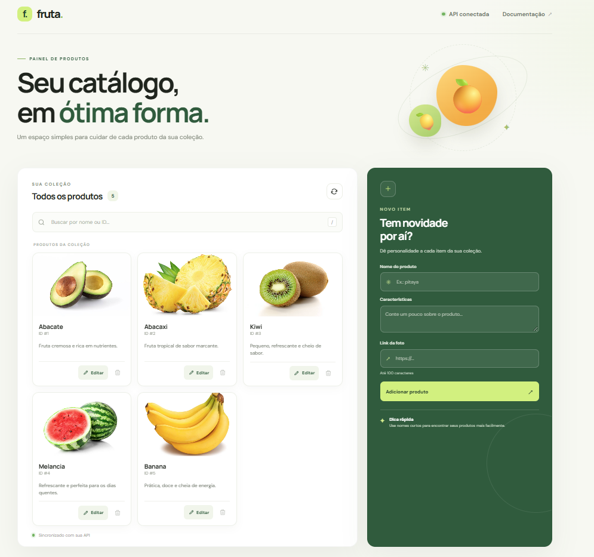

# Fruta API

API REST com um painel web responsivo para cadastrar e gerenciar um catálogo de
frutas. A interface permite consultar, filtrar, cadastrar, editar e remover
produtos.

## Visualização



## Funcionalidades

- Listagem de produtos em cards com nome, características e foto.
- Busca por nome ou ID.
- Cadastro, edição e remoção de produtos pela interface.
- URL de imagem opcional; se não for informada ou a imagem não carregar, o
  card exibe uma imagem genérica local.
- API documentada automaticamente pelo FastAPI.

## Tecnologias

- Python 3.10 ou superior
- FastAPI
- Pydantic
- Uvicorn
- HTML, CSS e JavaScript sem framework

## Executar localmente

Na raiz do projeto, crie e ative um ambiente virtual:

```bash
python3 -m venv .venv
source .venv/bin/activate
```

Instale as dependências e inicie o servidor:

```bash
pip install fastapi uvicorn
uvicorn app:app --reload
```

No Windows PowerShell, ative o ambiente virtual com:

```powershell
.venv\Scripts\Activate.ps1
```

Depois de iniciar a aplicação, acesse:

- Painel web: <http://127.0.0.1:8000>
- Documentação interativa da API: <http://127.0.0.1:8000/docs>
- OpenAPI: <http://127.0.0.1:8000/openapi.json>

Para encerrar o servidor, pressione `Ctrl+C` no terminal.

## Endpoints

| Método | Rota | Descrição | Resposta de sucesso |
| --- | --- | --- | --- |
| `GET` | `/produtos` | Lista todos os produtos | `200 OK` |
| `GET` | `/produtos/{produto_id}` | Busca um produto pelo ID | `200 OK` |
| `POST` | `/produtos` | Cadastra um produto | `201 Created` |
| `PUT` | `/produtos/{produto_id}` | Atualiza um produto existente | `200 OK` |
| `DELETE` | `/produtos/{produto_id}` | Remove e retorna um produto | `200 OK` |

Os IDs precisam ser inteiros positivos. A API retorna `404 Not Found` quando
um produto não existe e `422 Unprocessable Entity` quando os dados ou
parâmetros não passam pela validação.

## Modelo de produto

As respostas da API usam o formato:

```json
{
  "id": 1,
  "nome": "abacate",
  "descricao": "Fruta cremosa e rica em nutrientes.",
  "imagem_url": null
}
```

- `id`: identificador numérico gerado pela API.
- `nome`: obrigatório, entre 1 e 100 caracteres; espaços nas extremidades são
  removidos.
- `descricao`: característica opcional do produto.
- `imagem_url`: URL opcional, validada como HTTP ou HTTPS.

## Exemplos de uso

### Cadastrar um produto

Envie `nome` e, se desejar, `descricao` e `imagem_url`:

```bash
curl -X POST http://127.0.0.1:8000/produtos \
  -H "Content-Type: application/json" \
  -d '{
    "nome": "pitaya",
    "descricao": "Fruta de polpa doce e refrescante.",
    "imagem_url": "https://exemplo.com/imagens/pitaya.jpg"
  }'
```

### Atualizar um produto

`PUT` substitui os dados editáveis do produto. O nome é obrigatório; os campos
opcionais podem ser enviados como `null`.

```bash
curl -X PUT http://127.0.0.1:8000/produtos/1 \
  -H "Content-Type: application/json" \
  -d '{
    "nome": "abacate maduro",
    "descricao": "Fruta cremosa, pronta para consumo.",
    "imagem_url": "https://exemplo.com/imagens/abacate.jpg"
  }'
```

### Buscar e remover

```bash
curl http://127.0.0.1:8000/produtos/1
curl -X DELETE http://127.0.0.1:8000/produtos/1
```

## Estrutura do projeto

```text
.
├── app.py
├── image.png
├── README.md
└── static/
    ├── app.js
    ├── fruit-placeholder.svg
    ├── index.html
    └── styles.css
```

## Persistência

Os produtos são mantidos em memória. Ao reiniciar o servidor, a aplicação
volta aos produtos iniciais definidos em `app.py`; cadastros, edições e
remoções feitos durante a execução não são persistidos.
